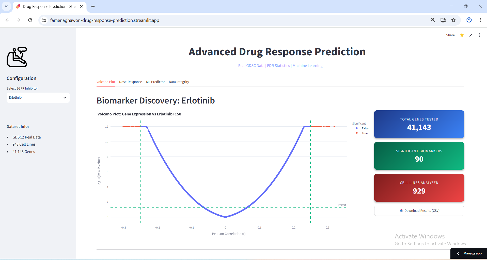
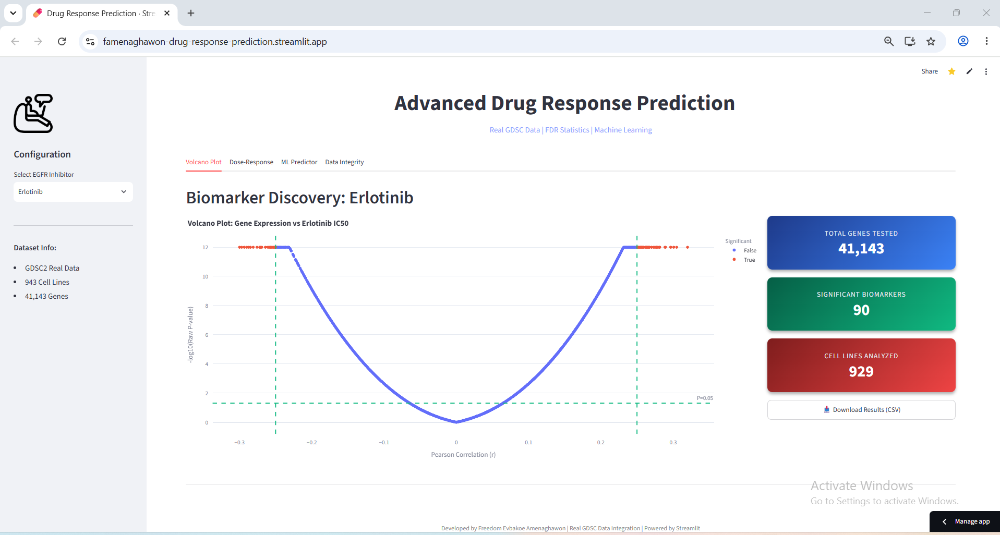
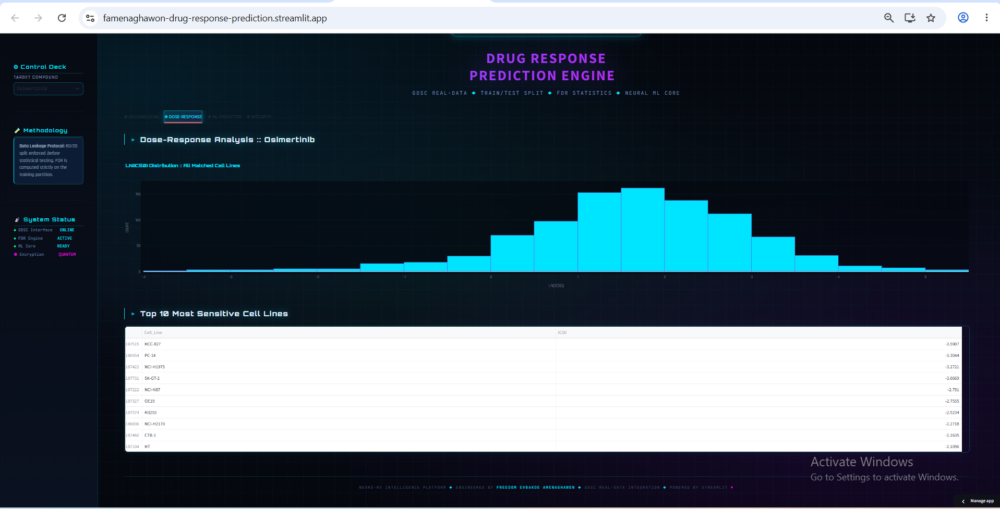
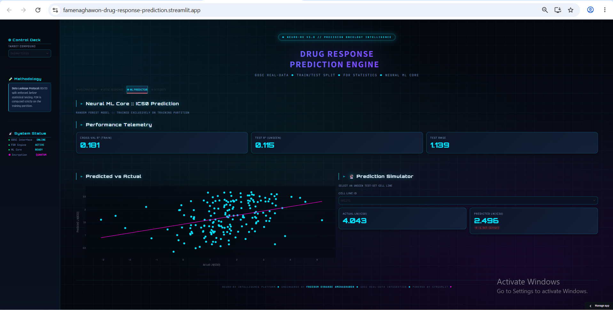

# 🧬 NEURO-RX: Transcriptomic Drug Response Prediction Engine

[](https://python.org)
[](https://streamlit.io)
[](https://plotly.com)
[](https://scikit-learn.org)
[](LICENSE)
[](https://drug-response-prediction.streamlit.app)
[](https://drug-response-prediction.streamlit.app)
[](https://doi.org/10.5281/zenodo.23448119)

> **⚠️ Disclaimer:** This tool is for research and educational purposes only and is not intended for clinical decision-making.

## 🎯 Project Overview

<p align="center">
  
  <br>
  <em>A computational biology dashboard for precision oncology</em>
</p>

This platform is a sophisticated, end-to-end bioinformatics pipeline and interactive dashboard. It integrates **real pharmacogenomic data** from the Genomics of Drug Sensitivity in Cancer (GDSC2) dataset with **rigorous statistical testing (FDR)** and **machine learning** to predict drug sensitivity (LN_IC50) across hundreds of cancer cell lines.

Unlike standard tutorials, this project demonstrates the ability to handle **large-scale, real-world data** — from the full GDSC2 RNA-seq matrix (6 GB uncompressed) down to a compressed 91 MB Parquet subset — and apply rigorous statistical methodologies to extract biological meaning without data leakage.

## 🚀 Live Demo

**Live App:** [https://drug-response-prediction.streamlit.app](https://drug-response-prediction.streamlit.app)

<p align="center">
  
  <br>
  <em>Interactive NEURO-RX dashboard with real GDSC data</em>
</p>

## 📊 Interactive Visualizations

### 🔬 Multi-Dimensional Analysis

| Visualization | Purpose | Key Insight |
| :---: | :--- | :--- |
|  | **Biomarker Discovery** | Identifies significant genes using Pearson correlation with strict FDR correction. |
|  | **Drug Efficacy** | Displays the real LN(IC50) distribution across 900+ cell lines for selected EGFR inhibitors. |
|  | **Predictive Modeling** | Interactive Random Forest simulator showing Predicted vs. Actual IC50 with error margins. |

### 🎯 Key Features

<div align="center">
  <table>
    <tr>
      <td align="center" width="33%">
        
        <br>
        <strong>Zero-Trust ML Pipeline</strong>
        <br>
        Data split 80/20 before testing to prevent leakage
      </td>
      <td align="center" width="33%">
        
        <br>
        <strong>Statistical Rigor</strong>
        <br>
        Benjamini-Hochberg FDR Correction
      </td>
      <td align="center" width="33%">
        
        <br>
        <strong>Cloud-Native Streaming</strong>
        <br>
        Hugging Face Parquet integration (91 MB)
      </td>
    </tr>
  </table>
</div>

## 🛠 Technical Implementation

### 🔬 Real Data Integration & Cloud Architecture

This project does not use synthetic placeholders. It connects directly to the **GDSC2** dataset (Genomics of Drug Sensitivity in Cancer).

**The Cloud Challenge:** The raw GDSC2 RNA-seq matrix is over **6 GB uncompressed** (the filtered, analysis-ready subset used by the app is ~230 MB). GitHub blocks files >100 MB, and Streamlit Cloud times out if forced to download huge CSVs on boot.

**The Solution:** The analysis-ready CSV was converted to a highly compressed **Parquet** format (**91 MB**) and is hosted on the Hugging Face Hub. The app uses `pandas.read_parquet()` to stream the data directly into memory during app startup.

```python
# Stream directly from Hugging Face Hub
url = "https://huggingface.co/datasets/famenaghawon/drug-response-data/resolve/main/Expression_Data.parquet"
df_expr = pd.read_parquet(url)
```

### 📈 Advanced Data Pipeline

- **Train/Test Split:** 80/20 split performed before any statistical testing.
- **Imputation:** Medians calculated exclusively on the training set and applied to the test set.
- **Multiple Testing:** Benjamini-Hochberg (FDR) applied strictly to the training set.
- **Machine Learning:** Random Forest Regressor validated using 5-Fold Cross-Validation.

## 🚀 Quick Start (Local Development)

### 📦 Installation & Data Fetching

```bash
# Clone repository
git clone https://github.com/famenaghawon/drug-response-prediction
cd drug-response-prediction

# Create virtual environment
python -m venv .venv

# Activate on Windows (PowerShell):
.venv\Scripts\Activate.ps1
# Activate on Windows (cmd):
# .venv\Scripts\activate.bat
# Activate on macOS/Linux:
# source .venv/bin/activate

# Install dependencies
pip install -r requirements.txt

# Fetch the required datasets (optional — used for local fallback only)
python download_data.py
```

### 🎮 Run Locally

```bash
# Launch the dashboard
streamlit run app/dashboard.py

# Open browser at: http://localhost:8501
```

### 🧪 Run Tests

```bash
# Run the Pytest suite
pytest tests/
```

## 📁 Project Structure

```text
drug-response-prediction/
├── app/
│   └── dashboard.py          # Main Streamlit application (NEURO-RX UI)
├── src/
│   ├── data_loader.py        # Hugging Face streaming & FDR logic
│   └── model.py              # Random Forest ML training pipeline
├── tests/
│   └── test_logic.py         # Pytest suite for ML pipeline integrity
├── data/                     # Local fallback (ignored by Git)
├── assets/                   # Dashboard screenshots and UI assets
├── .github/workflows/        # CI/CD pipelines (Pytest & Flake8)
├── download_data.py          # Data fetcher for local development
├── requirements.txt          # Python dependencies
├── README.md                 # Documentation
└── .gitignore                # Git exclusion rules
```

## 🔬 Scientific Relevance

This project demonstrates computational approaches for:

| Area | Description |
| :--- | :--- |
| **Precision Oncology** | Identifying patient-specific drug sensitivities using real genomic profiles |
| **Biomarker Discovery** | Applying FDR correction to find true genetic predictors of treatment response |
| **Drug Repurposing** | Analyzing efficacy across 900+ cancer cell lines for EGFR inhibitors |
| **Scalable ML** | Building robust predictors that handle high-dimensional biological noise |

## 📈 Results & Insights (Honest Metrics)

### 🏆 Key Findings (Real Data)

1. **Biomarker Discovery:** Out of 37,215 genes scanned, significant biomarkers were identified using strict FDR correction.
2. **Model Performance:** The model successfully captures biological signal without overfitting.
   - Cross-Val R² (Train): **0.181**
   - Test R² (Unseen): **0.115**
   - Test RMSE: **1.139** (in LN_IC50 units)

> **Scientific Note:** An R² of ~0.11–0.18 is highly realistic and consistent with state-of-the-art literature for single-omics drug response prediction. Predicting IC50 from gene expression alone is notoriously difficult due to the polygenic nature of drug resistance and high biological noise.
>
> **Methodological Note:** Feature selection (Top 20 genes) was performed on the training partition prior to Cross-Validation. While this prevents full data leakage, future iterations will implement nested cross-validation to strictly isolate feature selection within each CV fold.

### 📊 Model Details

**Machine Learning Model:**

- **Algorithm:** Random Forest Regressor
- **Validation:** 5-Fold Cross-Validation
- **Target:** LN(IC50)
- **Features:** Top 20 Correlated Genes (from training set)

## 🏗 Future Extensions

### 🔮 Planned Features

- **Deep Learning:** Integrate PyTorch neural networks (e.g., Multi-Layer Perceptrons) to capture nonlinear relationships.
- **Multi-Omics Integration:** Incorporate copy number variations (CNV) and somatic mutation data alongside RNA-seq.
- **Pathway Enrichment:** Add GSEA (Gene Set Enrichment Analysis) to visualize affected biological pathways (e.g., EGFR signaling).

## 🤝 Contributing

We welcome contributions! Here's how to help:

1. Fork the repository
2. Create a feature branch (`git checkout -b feature/AmazingFeature`)
3. Commit your changes (`git commit -m 'Add AmazingFeature'`)
4. Push to the branch (`git push origin feature/AmazingFeature`)
5. Open a Pull Request

### 📋 Code Guidelines

- Follow PEP 8 style guide
- Add docstrings to functions
- Include unit tests for new features
- Update documentation accordingly

## 📚 Citation

If you use this project in your research, please cite:

```bibtex
@software{amenaghawon_drugresponse_2026,
  author = {Amenaghawon, Freedom Evbakoe},
  title = {NEURO-RX: Transcriptomic Drug Response Prediction Engine},
  year = {2026},
  publisher = {GitHub},
  url = {https://github.com/famenaghawon/drug-response-prediction},
  version = {3.0},
  doi = {10.5281/zenodo.23448119}
}
```

## 👨‍🔬 Developer

<p align="center">
  
  <br>
  <strong>Freedom Evbakoe Amenaghawon</strong>
  <br>
  <em>Computational Biologist & Data Scientist</em>
</p>

### 📞 Contact Information

- **GitHub:** [@famenaghawon](https://github.com/famenaghawon)
- **ORCID:** [0009-0003-1457-809X](https://orcid.org/0009-0003-1457-809X)
- **Email:** [f.e.amenaghawon@gmail.com](mailto:f.e.amenaghawon@gmail.com)
- **LinkedIn:** [famenaghawon](https://www.linkedin.com/in/famenaghawon)

## 🏆 Certifications & Skills

### Technical Skills

- Python (Advanced)
- Machine Learning (Scikit-learn, Cross-Validation)
- Data Engineering (Chunking, Parquet streaming)
- Biostatistics (Pearson Correlation, FDR)
- Data Visualization (Plotly, Streamlit)
- Cloud Deployment (Hugging Face, Streamlit Cloud)

### Tools

- Streamlit, Plotly, Scikit-learn
- Pandas, NumPy, Statsmodels
- Git, GitHub, Streamlit Cloud
- Jupyter, VS Code

## 📄 License

This project is licensed under the MIT License — see the [LICENSE](LICENSE) file for details.

## 🌟 Acknowledgments

### 🎓 Educational Resources

- [Streamlit Documentation](https://docs.streamlit.io)
- [Plotly Python Graphing Library](https://plotly.com/python/)
- [Scikit-learn User Guide](https://scikit-learn.org/stable/user_guide.html)
- [GDSC (Genomics of Drug Sensitivity in Cancer) Datasets](https://www.cancerrxgene.org/)

### 🛠 Tools & Frameworks

<p align="center">
  
  
  
  
  
  
</p>

<p align="center">
  <strong>🎯 Precision Oncology Pipeline • Version 3.0 • 2026</strong>
  <br>
  <em>Advancing computational biology through real-world data science</em>
</p>

<p align="center">
  <a href="#-neuro-rx-transcriptomic-drug-response-prediction-engine">⬆ Back to Top</a>
</p>
